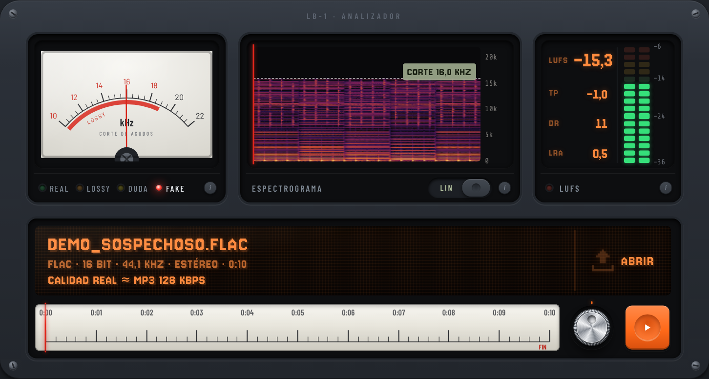
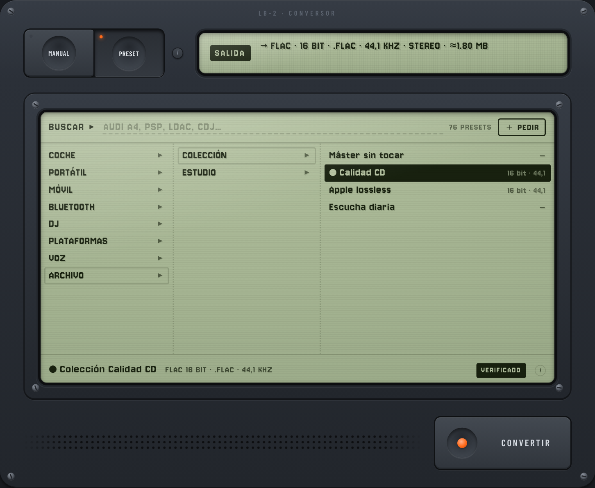
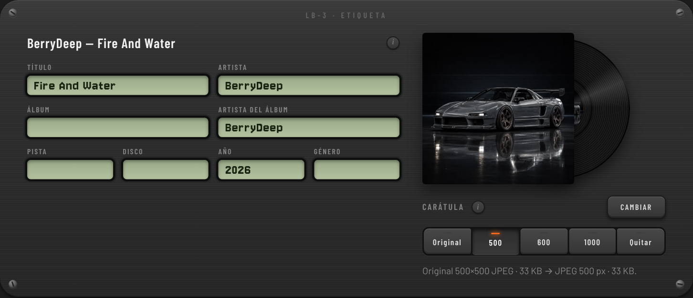

# Lossless Buddy

An audio converter and analyzer that runs entirely in the browser, designed as a piece of retro rack hardware. Drop in a file and it tells you whether that "lossless" FLAC is really a re-encoded MP3, measures its loudness, and converts it to whatever your car stereo, iPod, DJ deck or streaming platform actually plays. Nothing is uploaded: decoding, analysis and encoding all happen client-side.

**[Live demo →](https://eduardmcv.github.io/losslessbuddy/)**



## Features

**Analyzer (LB-1)**
- **Fake-lossless detection.** Finds the spectral cutoff and checks how abrupt it is, how stable it stays over time, band holes, upsampled hi-res and padded 24-bit. Gives a verdict (REAL / LOSSY / DUDA / FAKE) with a confidence score and the likely source bitrate (e.g. "≈ MP3 128 kbps"), mapped to LAME's lowpass table.
- **Loudness per ITU-R BS.1770-4 / EBU R128:** integrated LUFS, loudness range (LRA), 4× oversampled true peak and dynamic range. Results agree with `ffmpeg -af ebur128` to within ±0.05 LU.
- **Spectrogram** with linear or logarithmic frequency scale.
- **Analog-style playback.** Needle meter, LED ladder, and a tuning dial with a draggable wheel to pick the start point.

**Converter (LB-2)**
- **Encoders:** FLAC, ALAC, WAV, AIFF, MP3, AAC (LC/HE, CBR/VBR, `.m4a` / `.m4b` / ADTS) and Opus (`.opus` / `.ogg`).
- **Resampling, bit depth and channels:** resampling, TPDF dither, mono downmix, and normalization to a LUFS target or to peak, with a −1 dBTP ceiling.
- **Preset browser:** 76 presets organised by category › brand › model (car head units, portable players, phones, Bluetooth codecs, DJ gear, upload platforms, voice, archiving). It has search and keyboard navigation, and there is a "request a preset" flow for missing devices.
- **Test pack:** builds a zip of the same 30-second clip in 8 formats, to find what an unknown device accepts.

**Label (LB-3)**
- **Tags:** reads and writes ID3v2.3 (+ optional ID3v1), Vorbis comments, MP4 `ilst` atoms and RIFF INFO.
- **Cover art:** re-encodes the cover as a square baseline JPEG (500 / 600 / 1000 px) for head units that choke on large or progressive images.

| Converter | Label |
|---|---|
|  |  |

**Languages**
- English by default, Spanish one click away (EN/ES in the header, remembered per browser). Spanish is the source text; translations live in `src/js/i18n/` and `tests/i18n.mjs` fails the build if any visible string lacks an entry, so adding a language is one dictionary file.

## How it works

No frameworks and no bundler; it ships as one HTML file. Every container format is written by hand:

| Area | Implementation |
|---|---|
| Decoding / resampling | Web Audio `decodeAudioData`; sample-rate changes re-decode the source at the target rate (windowed-sinc) rather than using linear-interpolating playback |
| FLAC | Own encoder: fixed predictors (order 0–4), partitioned Rice coding, CRC-8/16, STREAMINFO + VORBIS_COMMENT + PICTURE blocks |
| ALAC | Own encoder: stereo decorrelation, adaptive Golomb coding, raw-frame fallback. Output decodes bit-exact in FFmpeg |
| AAC / Opus | WebCodecs `AudioEncoder` → own MP4 muxer (`esds`, `stts`, `ilst`, `covr`) and Ogg muxer (OpusHead/OpusTags, page lacing, CRC). Where the browser has no AAC encoder, FFmpeg's AAC-LC encoder compiled to WebAssembly takes over |
| MP3 | [lamejs](https://github.com/zhuker/lamejs) + own ID3v2.3 writer |
| WAV / AIFF | Own writers incl. `LIST/INFO`, 80-bit extended sample rate and `ID3 ` chunk |
| Analysis | K-weighting biquads, gated loudness, polyphase true-peak, FFT spectrogram |

```
src/
├── index.html            markup + script order
├── assets/               preview track (inlined into dist at build time)
├── css/                  design tokens (graphite) and faceplate styles
├── vendor/               FFmpeg AAC encoder (WASM), regenerated by tools/vendor-aac.mjs
└── js/
    ├── i18n.js, i18n/    translation function, language switch, dictionaries
    ├── core.js           helpers, format matrix, help texts, app state
    ├── audio.js          header sniffing, fallback demo signal, processing chain
    ├── measure.js        BS.1770 loudness, true peak, DR, fake detection
    ├── meta.js           tag/cover read and write
    ├── presets.js        device preset database
    ├── zip.js            store-only zip writer
    ├── codecs/           FLAC/WAV/MP3/AAC, ALAC, AIFF + Ogg Opus, MP4 muxer
    ├── ui/               preset browser, needle/ladder/knobs/tuner
    └── app.js            analysis, playback, conversion, rendering, events
```

## Getting started

Open `src/index.html` directly in a browser to develop. No server is required.

```bash
npm install && npx playwright install chromium   # only needed for tests
npm run build      # inline everything into dist/index.html
npm test           # build, then run the end-to-end encoder checks
```

`tests/detector.mjs` calibrates the fake-lossless detector: it builds real and MP3-transcoded fixtures with FFmpeg (including TPDF and noise-shaped dither, which hide a lossy lowpass from naive threshold detection) and checks each verdict and estimated bitrate.

The end-to-end test loads the app in headless Chromium, checks the analysis and tag reading on the preview track, and encodes it to every format the browser supports. If `ffprobe` is installed, each output is then decoded with FFmpeg and its codec, sample rate and channel count are verified.

## Browser support

The analyzer, the lossless encoders and AAC-LC (CBR) run in any modern browser: AAC uses the native WebCodecs encoder when there is one and the bundled WebAssembly encoder otherwise (Firefox, Brave, Chrome on Linux). HE-AAC, AAC VBR and Opus need native WebCodecs support. Codecs the browser can't encode are shown as unavailable rather than failing.

## License

Code: [MIT](LICENSE). Bundled third-party code: see [src/vendor/NOTICE.md](src/vendor/NOTICE.md) (FFmpeg AAC encoder, MPL-2.0 / LGPL-2.1+).

Preview track: 20-second excerpt of "Fire And Water" by BerryDeep.
